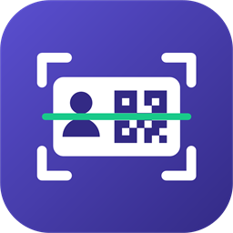
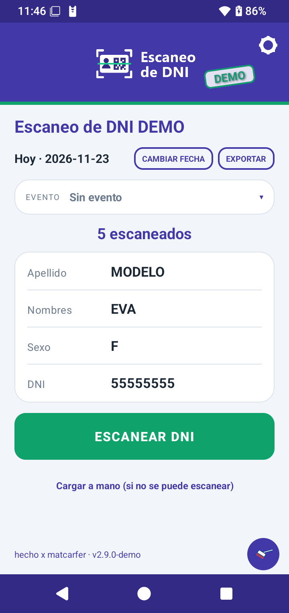
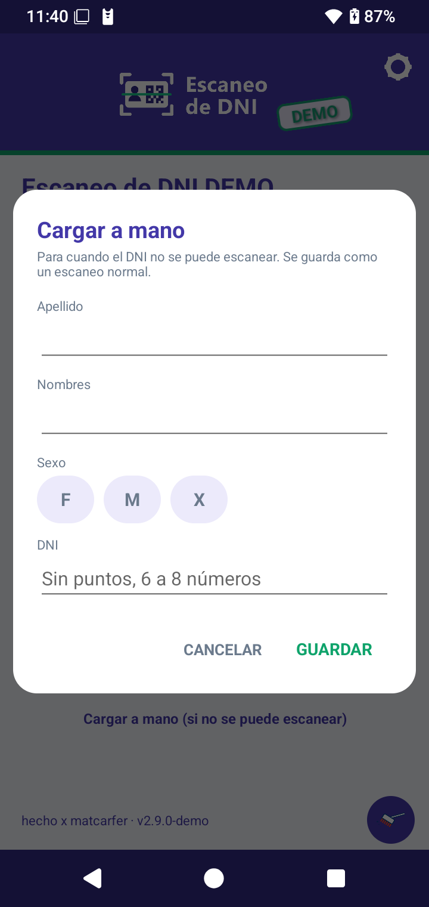
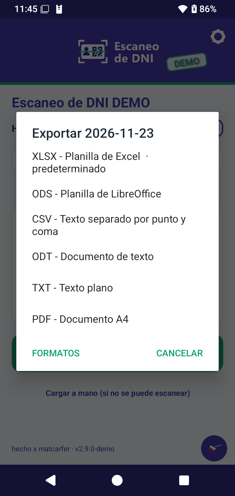

<h1 align="center">Escaneo de DNI</h1>

<h2 align="center"><a href="https://github.com/matcarfer/escaneo-dni-demo/releases/download/v2.9.0/Escaneo-de-DNI-DEMO-2.9.0.apk">⬇ Download free DEMO</a></h2>

  <a href="README.md">Español</a> · <b>English</b>  
  <b>Check people in at your event with a phone.</b> 
  Scan the QR of the Argentine ID card (DNI), confirm, next. App in Spanish. 
  <b>Compatible with Android 7 to 16.</b>

  
  
  

## Why it helps

- **No queues:** nothing is written by hand.
- **No mistakes:** the data comes from the ID card.
- **No internet:** it works anywhere and the data never leaves the phone.
- **Instant list:** Excel, PDF and more.

## With your brand

Sold customized: your logo, your colors, the data you need and support during the event. Ideal for fairs, congresses, chambers, city councils, clubs and universities.

<h3 align="center">Ask for a free quote: <a href="mailto:matcarfer@gmail.com">matcarfer@gmail.com</a></h3>

---

The demo allows 5 records. Proprietary software, for evaluation only, no warranty. Whoever operates it is responsible for the use of personal data. <a href="LICENSE.en">License</a> · <a href="https://www.virustotal.com/gui/file/aafaeccad2c05d5a16330b45fab355e2137ff66cfad2c76363e13443d3995c32">VirusTotal</a> · <a href="https://github.com/matcarfer/biblioteca/blob/main/README.en.md">📚 Software library</a>
