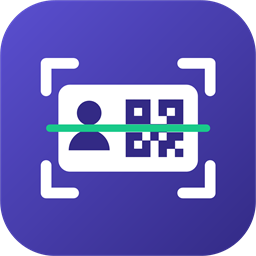
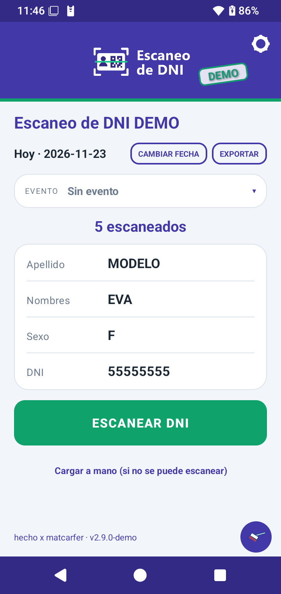
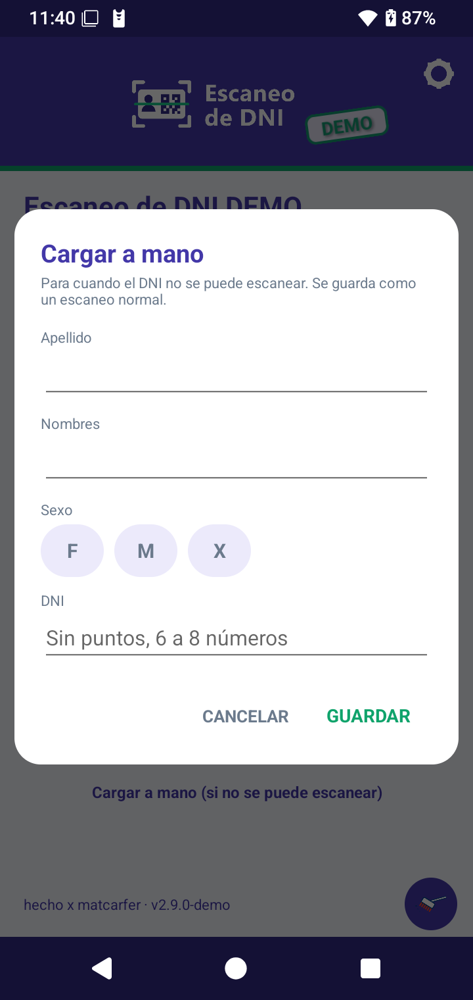
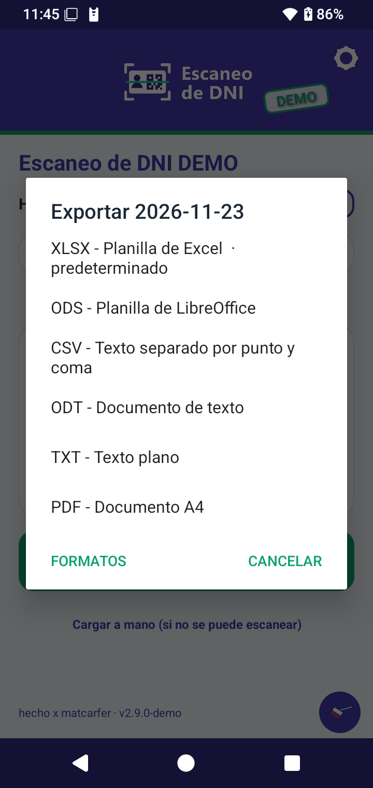

<h1 align="center">Escaneo de DNI</h1>

<h2 align="center"><a href="https://github.com/matcarfer/escaneo-dni-demo/releases/download/v3.0.0/Escaneo-de-DNI-DEMO-3.0.0.apk">⬇ Descargar DEMO gratis</a></h2>

  <b>Español</b> · <a href="README.en.md">English</a>  
  <b>Acreditá gente en tu evento con un celular.</b> 
  Escaneás el QR del DNI, confirmás y pasa el siguiente. 
  <b>Compatible con Android 7 a 16.</b>

  
  
  

## Por qué te conviene

- **Sin filas:** no se escribe nada a mano.
- **Sin errores:** los datos salen del DNI.
- **Sin internet:** funciona en cualquier lado y los datos no salen del celular.
- **Listado al instante:** Excel, PDF y más.

## Con tu marca

Se vende personalizada: tu logo, tus colores, los datos que necesites y soporte durante el evento. Ideal para ferias, congresos, cámaras, municipios, clubes y universidades.

<h3 align="center">Pedí tu presupuesto sin cargo: <a href="mailto:matcarfer@gmail.com">matcarfer@gmail.com</a></h3>

---

La demo permite 5 registros. Software propietario, solo para evaluación, sin garantía. El uso de los datos personales es responsabilidad de quien la opera (Ley 25.326). <a href="LICENSE">Licencia</a> · <a href="https://github.com/matcarfer/biblioteca">📚 Biblioteca de software</a>
